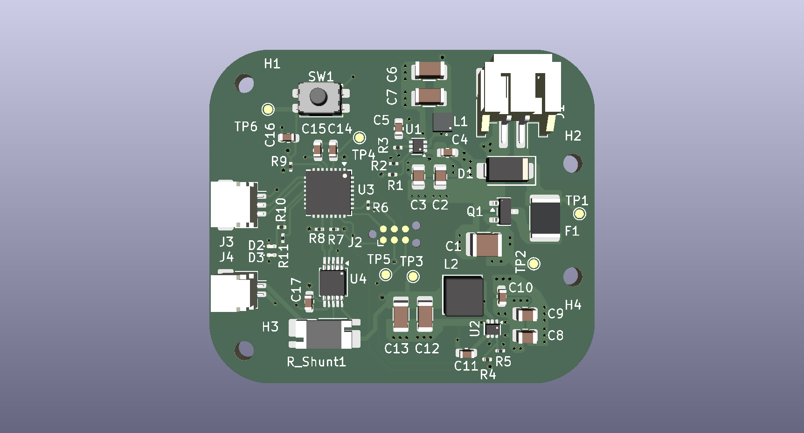

# UAV-PHMC
### Payload Management & Health Controller

UAV-PHMC is an embedded hardware project: a custom four-layer printed circuit board (PCB) for power management, health monitoring and payload interfacing on a small UAV.

The board is designed to be light and to run from a 2S battery pack. It was modelled around the Ornadyne O1, a crow-shaped, propeller-free flapping-wing reconnaissance drone. This is an independent design and is not affiliated with Ornadyne.

The repository contains the KiCad hardware design files alongside manufacturing outputs for PCB fabrication and assembly.

<p align="center">
  
</p>

---

## Project Overview

The UAV-PHMC board is built around the **STM32G071KBUx** microcontroller. It regulates the battery input into the rails the airframe needs, monitors voltage and current, and gives a companion computer and a camera a protected supply and a serial link.

Key design areas include:

- Custom four-layer PCB design.
- STM32G071KBUx microcontroller integration.
- 2S battery input with polyfuse and TVS protection.
- Multi-rail power distribution with two buck regulators.
- Voltage and current monitoring.
- Companion connector and switched camera power connector.
- SWD debug through a Tag-Connect footprint.
- PCB fabrication and assembly preparation.

## Hardware Features

| Feature | Description |
|---|---|
| Microcontroller | STM32G071KBUx |
| PCB | Custom four-layer design |
| Battery input | 2S pack, with polyfuse (F1) and SMAJ10A TVS (D1) |
| Power regulation | Two TPS562202S buck converters |
| Current monitoring | INA226 with a 0.1 ohm shunt |
| Power rails | VBAT_RAW, VBAT_PROT, 5V, 5V_CAM, 3V3 |
| Communication | UART (USART2), I²C (I2C1) |
| Connectors | Battery (J1), companion (J3), camera power (J4) |
| Debug | SWD through Tag-Connect TC2030-NL |
| Design software | KiCad |

## Power Architecture

The hardware design incorporates multiple power domains to support the board and its connected peripherals.

| Power net | Purpose |
|---|---|
| VBAT_RAW | Raw battery input |
| VBAT_PROT | Battery rail after the input protection stage |
| 5V | Main regulated 5V supply |
| 5V_CAM | Camera power supply |
| 3V3 | Logic and microcontroller supply |

The design includes voltage and current monitoring using the INA226, supporting power-system observation and integration.

## Repository Structure

```text
UAV-PHMC/
│
├── hardware/
│   ├── bom/
│   │   └── hardware.csv
│   │
│   ├── gerbers/
│   │   ├── PHMC_gerbers.zip
│   │   ├── hardware-Front.gtl
│   │   ├── hardware-Back.gbl
│   │   ├── hardware-Edge_Cuts.gm1
│   │   └── ... fabrication layers and drill files
│   │
│   ├── libraries/          custom footprints and 3D models
│   ├── pick_place/
│   │   └── hardware-all.pos
│   │
│   ├── hardware.kicad_pro
│   ├── hardware.kicad_sch  top-level schematic
│   ├── Power_Input_Protection.kicad_sch
│   ├── Current_Sense.kicad_sch
│   ├── MCU.kicad_sch
│   ├── Connectors_Comms.kicad_sch
│   ├── hardware.kicad_pcb
│   ├── hardware.net
│   ├── hardware.glb
│   └── front.png, back.png, hardware.png
│
├── references/             component datasheets
│   ├── stm32g071c8.pdf
│   ├── tps562202s.pdf
│   └── ina226.pdf
│
├── LICENSE
├── LICENSE-MIT
├── .gitignore
└── README.md
```

## Manufacturing Outputs

The repository includes the following manufacturing-related files:

**Bill of Materials (BOM)**
- `hardware/bom/hardware.csv`

**Gerber and Drill Files**
- `hardware/gerbers/`

**Pick-and-Place Data**
- `hardware/pick_place/hardware-all.pos`

**3D PCB Model**
- `hardware/hardware.glb`

**Gerber Archive**
- `hardware/gerbers/PHMC_gerbers.zip`

These files are provided to support PCB fabrication, component sourcing, assembly preparation, and design review.

Before manufacturing, verify that the Gerber outputs, drill files, BOM, and pick-and-place data correspond to the intended PCB revision.

## Opening the Hardware Design

1. Install [KiCad](https://www.kicad.org/).
2. Clone or download this repository.
3. Navigate to the `hardware/` directory.
4. Open `hardware.kicad_pro` in KiCad.
5. Inspect the schematic and PCB design as applicable.

The 3D model can also be inspected using a compatible 3D viewer.

## Project Status

**Hardware design and manufacturing outputs committed.**

The repository currently includes the PCB design, project configuration, BOM, Gerber fabrication files, drill data, pick-and-place coordinates, and 3D model.

The inclusion of manufacturing outputs does not imply that the board has been fabricated, assembled, electrically validated, or flight-tested.

## Tools & Technologies

- **KiCad**: PCB design and layout.
- **STM32**: Embedded microcontroller platform.
- **INA226**: Voltage and current monitoring.
- **TPS562202S**: Power regulation.
- **Gerber**: PCB fabrication data.
- **3D CAD**: PCB visualization and mechanical inspection.

## Licensing

### Hardware design

The hardware design files in this repository, including schematics, PCB layouts, manufacturing outputs and related hardware documentation, are licensed under the **CERN Open Hardware Licence Version 2 – Strongly Reciprocal (CERN-OHL-S-2.0)**. See [LICENSE](./LICENSE).

The complete source for this hardware design is available in this repository: https://github.com/Evans-Kwashie/UAV-PHMC

### Software

Any firmware, software or code in this repository that is explicitly identified as software is licensed under the **MIT License**. See [LICENSE-MIT](./LICENSE-MIT). Third-party components remain under their respective licences.

## Author

**Evans Klenam Kwashie-Seyram**

- GitHub: [@Evans-Kwashie](https://github.com/Evans-Kwashie)
- LinkedIn: [Evans Klenam Kwashie-Seyram](https://linkedin.com/in/evans-klenam-kwashie-seyram)
- Portfolio: [pcb-portfolio.vercel.app](https://pcb-portfolio.vercel.app)

---

*UAV-PHMC: custom embedded hardware for UAV systems.*
